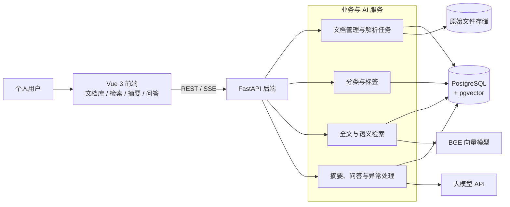

# 个人文档智能整理与语义检索系统：需求、场景与架构

> 文档状态：需求与架构基线  
> 更新日期：2026-11-24

## 1. 项目定位

本系统面向个人学习资料的统一管理，解决资料格式不一、分散存放、难以查找和复用的问题。系统支持 PDF、Word（`.docx`）和 TXT 文档的上传、分类、标签、解析、全文检索、语义检索、自动摘要及基于文档内容的自然语言问答，并对大模型输出进行基本准确性评价。

本期按个人单用户系统设计，不包含团队协作、权限矩阵、模型训练和扫描件 OCR。旧版 `.doc` 文件需另存为 `.docx` 后上传。

## 2. 技术栈

系统采用 Vue 3 + TypeScript 构建前端，Python 3.12 + FastAPI + SQLAlchemy/Alembic 构建后端，以 PostgreSQL（pgvector）统一保存业务数据与文档向量，结合 jieba 分词、BGE 向量模型和 OpenAI 兼容大模型 API 完成全文/语义检索、自动摘要与检索增强问答。

原始文档保存在后端文件目录，PostgreSQL 保存元数据、解析文本、分块和向量。API Key 只通过环境变量配置，不写入代码或数据库明文字段。

## 3. 功能模块

| 模块 | 功能范围 |
|---|---|
| M01 用户与会话 | 单用户登录、身份校验和会话管理 |
| M02 文档管理 | 上传 PDF、DOCX、TXT，查看、重命名、删除和状态展示 |
| M03 分类与标签 | 分类管理、标签管理、文档分类和文档多标签 |
| M04 解析与索引 | 文本提取、页码与字符位置记录、分块、向量化、任务进度和失败重试 |
| M05 检索 | 关键词检索、全文检索、语义检索及结果片段定位 |
| M06 文档摘要 | 自动生成摘要、要点和关键词，保存生成模型与时间 |
| M07 智能问答 | 基于已入库文档进行自然语言提问 |
| M08 大模型服务与评价 | API 配置、超时重试、异常降级、调用记录及摘要和问答准确性评价 |

### 3.1 功能需求

| 编号 | 需求 | 验收重点 |
|---|---|---|
| FR-01 | 用户登录与会话 | 未登录不能访问文档和智能功能；登录状态可安全失效 |
| FR-02 | 文档上传与管理 | 三种格式可上传；非法类型、超限文件和解析失败有明确提示 |
| FR-03 | 分类与标签 | 文档可归入分类，可添加多个标签，删除分类或标签时不破坏文档 |
| FR-04 | 文档解析 | 提取正文、页码和字符位置；解析结果可被检索和问答复用 |
| FR-05 | 关键词与全文检索 | 能按关键词返回相关文档或片段，并显示命中位置 |
| FR-06 | 语义检索 | 自然语言查询可召回语义相关片段，并可与关键词结果融合呈现 |
| FR-07 | 文档摘要 | 可为指定文档生成摘要、要点和关键词，记录模型及生成时间 |
| FR-08 | 文档问答 | 回答仅使用检索到的文档证据，附引用；证据不足时明确拒答 |
| FR-09 | 大模型异常处理 | 超时、限流、鉴权失败和服务异常不会导致系统崩溃，并给出可理解提示 |
| FR-10 | AI 结果评价 | 使用固定样例评价摘要与问答的事实一致性、完整性和引用准确性 |
| FR-11 | 系统测试与交付 | 覆盖核心流程、异常流程和基本性能；提供运行说明、数据库脚本和测试记录 |

## 4. 系统架构

架构说明：前端通过 REST 调用业务接口，问答可通过 SSE 流式展示；后端在同一 PostgreSQL 中完成业务查询和向量检索；原始文档与数据库分离保存；摘要和问答通过大模型 API 生成，检索与文档管理在模型不可用时仍可工作。

## 5. 数据结构设计

| 数据对象 | 主要字段或关系 |
|---|---|
| `users` | 账号、密码哈希、显示名、创建时间 |
| `documents` | 用户、标题、原文件名、存储路径、文件哈希、格式、大小、状态、分类 |
| `categories` | 名称、所属用户；文档与分类为多对一 |
| `tags` / `document_tags` | 标签名称；文档与标签为多对多 |
| `document_chunks` | 文档、页码、字符起止位置、正文分块、分词检索字段、向量、模型版本 |
| `ingestion_tasks` | 文档、任务阶段、进度、重试次数、错误信息和更新时间 |
| `summaries` | 文档、摘要、要点、关键词、模型名称、生成时间 |
| `qa_sessions` / `qa_messages` | 会话、问题、回答、模型信息和状态 |
| `qa_citations` | 回答、文档、分块、页码和引用片段 |
| `llm_calls` | 调用类型、模型、耗时、状态、错误类型和请求追踪号 |

文档原文件存放在 `backend/data/uploads/<document_id>/` 下，数据库只保存受控路径和文件元数据。`document_chunks` 同时保存用于中文全文检索的分词结果与 pgvector 向量，避免再维护独立向量库。

## 6. 使用场景

| 编号 | 场景 | 主流程 | 结果 |
|---|---|---|---|
| UC-01 | 导入与整理资料 | 登录 → 上传文档 → 系统校验并解析 → 用户设置分类和标签 | 文档进入可检索、可问答状态 |
| UC-02 | 按关键词查找资料 | 输入关键词 → 查询全文索引 → 打开命中文档和片段 | 快速定位原文位置 |
| UC-03 | 用自然语言查找内容 | 输入问题或描述 → 关键词与向量混合召回 → 按相关度展示片段 | 找到语义相关但未使用原词的资料 |
| UC-04 | 生成学习摘要 | 打开文档 → 生成摘要 → 查看摘要、要点和关键词 | 获得可追溯的模型生成结果 |
| UC-05 | 基于资料提问 | 选择文档范围 → 提问 → 检索证据 → 模型生成带引用回答 | 获得有来源依据的答案；证据不足时拒答 |
| UC-06 | 大模型服务异常 | 请求超时、限流或鉴权失败 → 系统重试或降级 → 返回明确提示 | 文档管理和检索不受影响，用户可稍后重试 |
| UC-07 | 评价 AI 输出 | 使用固定文档和问题集 → 逐项评分 → 汇总结果 | 形成摘要和问答准确性评价记录，用于论文分析 |

## 7. 非功能需求

| 类别 | 要求 |
|---|---|
| 性能 | 在不少于 100 篇文档、1 万条分块的演示数据下，排除模型冷启动和大模型生成时间，检索响应目标为 3 秒以内 |
| 可靠性 | 入库任务支持失败重试和启动恢复；文档、分块、任务状态使用数据库事务保证一致 |
| 安全性 | 校验文件类型、MIME 和大小；阻止路径穿越；密码哈希保存；API Key 使用环境变量；日志不记录密钥和完整敏感内容 |
| 可用性 | 大模型不可用时返回可理解的降级状态，不影响登录、上传、管理和普通检索 |
| 兼容性 | 支持 PDF、DOCX 和 UTF-8 TXT；前端适配主流现代浏览器 |
| 可维护性 | 使用 database migration 管理表结构；核心 API、解析、检索和大模型异常路径具备自动化测试 |

### 7.1 大模型异常处理

- 鉴权失败、参数错误和内容违规不进行盲目重试，直接返回明确错误类型。
- 超时、限流和临时服务错误采用有限次数重试与退避，并设置总超时。
- 对重复提交使用请求幂等标识，避免重复计费或生成多条相同任务。
- 保存调用状态、耗时和错误类型，不记录 API Key；连续失败时进入短期降级状态。
- 摘要和问答失败时保留检索结果，提示用户重试或切换模型。

### 7.2 AI 结果准确性评价

建立固定的评测集，建议覆盖 20—30 篇不同格式文档和 30—50 个问题。摘要按事实一致性、要点覆盖度和无依据内容三个维度评分；问答按答案正确性、完整性、引用准确性和拒答合理性评分。评分采用明确的 1—5 分量表，记录模型、提示词版本和日期，结论以实际测试数据为准。

